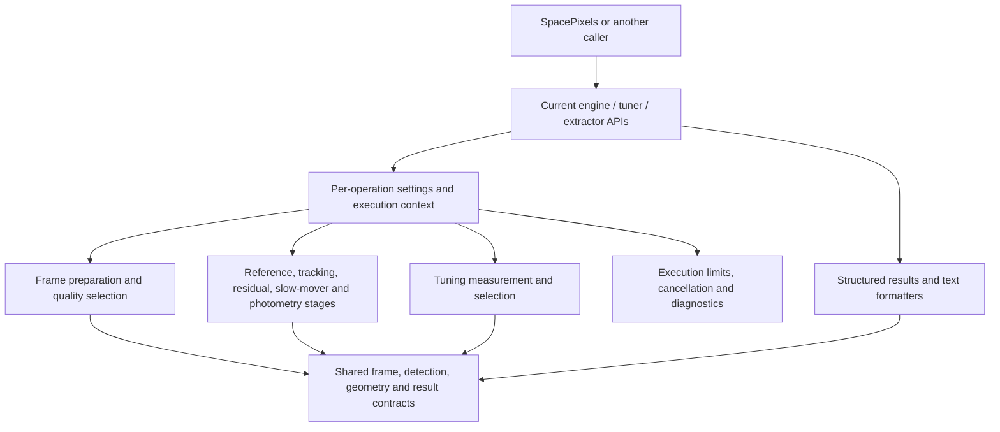

# Design and architecture improvements

This is the current design and pending implementation plan, not an implementation diary. API/scientific details belong in [PIPELINE.md](PIPELINE.md), [ALGORITHM.md](ALGORITHM.md) and [CONFIG.md](CONFIG.md). Completed rationale, measurements and prior questions are in the [closed archive](docs/archive/design-improvements-closed-2026-10.md) and [architecture explanations](docs/archive/architecture-clarifications-2026-10-23.md). The final table indexes every original request without reactivating deferred/declined work.

## Goals and development policy

Develop SpacePixels, JTransient and JPlateSolve together with both local composite flags enabled. Change library APIs and consumers directly; old Java signatures, version probing and compatibility facades are not requirements. Pin and validate one selected artifact combination at release time. Preserve scientific outputs, detection identity, intended buffer aliases, cancellation ownership and user data unless an explicitly agreed feature changes them.

### Architectural goals

- **The library/application boundary and simple entry points.** Keep `short[][]` processing usable without SpacePixels, FITS readers, Swing, application settings or report services. Keep standalone `SourceExtractor`, both tuners and the engine facade available during migration.
- **Existing scientific boundaries.** `SkyBackground`, coverage/registration/data-area types, `MasterReferenceAnalyzer`, the camera/common-motion rejectors and the slow-mover analyzers already isolate useful responsibilities. Photometry has separate selection, measurement, readiness, ensemble and scoring helpers. Static methods are appropriate for stateless computations.
- **Stage-local configuration copies.** Master-reference, quality, slow-mover and photometry extraction already clone settings before applying local overrides. Preserve that practice while improving the outer run boundary.
- **Shared preparation and measured diagnostics.** Full detection and transient-only export share `extractSourcesFromFrames`; master generation shares the rejection policy. Stage timings use a monotonic clock, and photometry distinguishes readiness outcomes. Build on these instead of adding a second pipeline.
- **Memory-conscious sharing and identity.** Image/mask aliases avoid large duplicate allocations. Detections intentionally appear in several review collections, and classification uses object identity. Preserve those relationships until an explicit replacement contract is agreed.
- **The regression discipline.** Existing focused tests and the SpacePixels reference-data comparison are essential safeguards when moving scientific code without changing its behavior.

## Package and class analysis

### Current dependencies

The graph is only partly layered: orchestration calls science services, while shared engine-package frames/callbacks and nested model types still create reverse dependencies. Adopted config/execution boundaries and facade-independent diagnostic access are enforced by bytecode checks; JA-07 addresses remaining shared contracts.

`core` contains extraction, image geometry, stacks, tracking, slow movers and residual analysis. Its classes often have useful responsibilities, but the package does not express those boundaries. Conversely, `photometry` already gives its helpers a coherent home and uses package-private implementation classes. Keep that pattern. `PipelineTelemetry` has no imports of the science packages today, but placing their frame records inside it makes those packages depend on a pipeline-level container; moving diagnostics must reverse that ownership carefully.

There are also dependencies hidden by today's shared package: `TrackLinker` calls the streak-shape predicate on `SourceExtractor`, and deprecated `CommonMotionRejector.apply` recomputes residual analysis. The blueprint assigns the shape predicate to tracking with shared footprint geometry below it; the deprecated cross-stage operation remains a compatibility adapter. These are specific dependency changes to verify, not imports to rename mechanically.

### Target package layout and allowed dependencies

All names are beneath `io.github.ppissias.jtransient`. The dependencies column names permitted **direct project-package dependencies**, in addition to the JDK and existing justified external dependencies. It describes canonical implementations; update application imports/callers with package changes instead of requiring historical-name facades. Packages do not become separate artifacts.

| Package | Owns | Allowed project dependencies |
|---|---|---|
| `model` | Shared frame/detection/track contracts: top-level `ImageFrame`, `DetectedObject`, `Pixel`, `Track`, `AnomalyDetection` and `AnomalyType`. Only data used across stages belongs here. | None. |
| `config` | Existing `DetectionConfig` schema, shared `DetectionConfigRules`, field/range metadata, validation issues, alignment results and captured settings. | None; preserve the existing Gson annotation dependency. |
| `execution` | `ExecutionPolicy`, `OperationContext`, cancellation/progress/diagnostic contracts, stage identity/outcomes and `ExecutionSession` for owned or borrowed resources. | None. |
| `image` | Pixel encoding, coverage, registration, data areas, drift analysis, shared spatial lookup, `BlobGeometry`/`FootprintGeometry` and `FrameSequenceValidator`. `SkyBackground` remains an image transformation here. | `model`, `execution` (optional operation control for computations). |
| `extraction` | Standalone `SourceExtractor`, extraction/background results and private component-growth/morphology helpers when needed. | `model`, `image`, `config`, `execution`. |
| `quality` | `FrameQualityAnalyzer`, `SessionEvaluator`, top-level `FrameMetrics` and `SessionThresholds`; quality measurements and rejection decisions. | `model`, `image`, `config`, `execution`, `extraction`. |
| `reference` | `MasterMapGenerator`, `MasterReferenceAnalyzer`, `MasterVetoMask`, reference results and `PreparedMasterReference` provenance. | `model`, `image`, `config`, `execution`, `extraction`. |
| `tracking` | `TrackLinker` stage facade, vetoing, streak/point association, assignment/rescue, camera/common-motion filtering and their results/diagnostics. | `model`, `image`, `config`, `execution`, `reference`. |
| `residual` | `ResidualTransientAnalyzer` and local-rescue/activity-cluster results over final leftovers. | `model`, `image`, `config`, `execution`. |
| `slowmover` | Maximum-stack morphology/evidence analysis, candidates, diagnostics and its result bundle. | `model`, `image`, `config`, `execution`, `extraction`, `reference`. |
| `photometry` | Existing photometry stage/helpers/results plus its own input and frame/diagnostic contracts. | `model`, `image`, `config`, `execution`, `extraction`, `quality` (measurement contracts only). |
| `tuning` | Calibrated and legacy tuner facades, options, sampling, measurements, selection policies, summaries and text formatters. | `model`, `image`, `config`, `execution`, `extraction`, `quality`, `reference`. |
| `telemetry` | Pipeline diagnostic aggregation and text formatting, including compatibility projections of feature diagnostics. | `model`, `image`, `config`, `execution`; diagnostic/result contracts from `extraction`, `quality`, `reference`, `tracking`, `residual`, `slowmover`, `photometry`, `tuning`. |
| `engine` | Public pipeline facade/results, private preparation and pipeline orchestration, and adapters for existing engine entry points. | All listed packages as needed; no canonical stage depends on `engine`. |

`core` may temporarily hold not-yet-migrated classes, but old public names need not remain as compatibility facades. Add new computational code to the package owning its responsibility. No new `util`, `common`, `manager` or `service` catch-all package is proposed. Keep the existing `engine` entry-point package rather than introducing a second `api` package solely to rename the facade location.

The dependency rules have practical consequences:

- Foundation contracts do not import analyzers, pipeline results or aggregate telemetry. `model` does not acquire settings, executor ownership or reporting behavior.
- Quality and reference construction use extraction independently. Neither calls the full engine, and neither depends on the other to perform QC orchestration. The engine selects frames, then requests references from that selection.
- Tracking consumes extracted observations and a reference mask; it does not run extraction, slow movers or photometry. Put mask construction/overlap mechanics in `reference` when genuinely shared; preserve the distinct masks' scientific semantics.
- Camera-fixed filtering stays inside tracking before point association. Common-motion filtering stays a separately invoked tracking operation after tracking and before residual analysis. The engine owns this order. Moving a class into `tracking` does not move its execution earlier.
- The canonical common-motion rejector does not recompute residual analysis. Keep deprecated `CommonMotionRejector.apply` at the legacy boundary with its existing behavior, routing its two operations through the appropriate public component facades.
- Photometry receives canonical tracks and slow-mover detection footprints as data. It does not call either detector or depend on their implementation classes. Its own star extraction, selection and mask retain their current purpose.
- Tuning calls lower-level image/extraction/quality/reference components, never `JTransientEngine.runPipeline`. Preserve its separate sample/measurement policies. Neither scientific stages nor shared profile validation depend on tuning.
- Each stage owns its diagnostic types. `telemetry` aggregates them; it does not supply the types a stage must instantiate. Stages receive a narrow execution context instead of importing `PipelineTelemetry` or reading engine statics.
- No canonical package cycle is allowed. Calls between features must follow the table; when an apparent reverse dependency appears, pass the required data or extract a genuinely shared lower-level contract before adding the import.

### Class separations and ownership

These are concrete destinations for responsibilities, not a requirement to create one class for every method. Keep each stage's coordinator and helpers in the **same Java package** so helpers can be package-private; subpackages do not share package-private access. Existing cohesive static computations may remain static.

| Current responsibility | Proposed classes and boundary | State/visibility rule |
|---|---|---|
| Engine entry points, executor sizing, stage order, result assembly | `engine.JTransientEngine` delegates to package-private `PipelineRunner`, `FramePreparationService` and `PipelineResultBuilder`. Shared scheduling/resource policy lives in `execution`. | Facade owns engine lifetime; an operation owns its context and work. Helpers do not retain a caller's live config. |
| Parallel lists in `ExtractedFramesContext` and repeated master-only preparation | Package-private `engine.PreparedFrame` pairs frame, metrics, detections and registration; `PreparedSequence` groups selection/data-area facts. `FramePreparationService` shares selection policy and supports quality-only versus full extraction. | Keep explicit original sequence identity and retained position. Pass feature-specific inputs to stages; never export `PreparedSequence` into lower-level packages. |
| Input sequence rules currently in engine-only `InputRules` | `image.FrameSequenceValidator` owns dimensions, metadata availability, exposures, sequence identity and optional master-dimension checks. | Public reusable validation component; entry points still decide their own minimum frame counts and fallback outcomes. File-format validation remains in SpacePixels. |
| Profile values and GUI pair alignment | Implemented `config.DetectionConfigRules` exposes `FieldMetadata`, `Issue`, `Alignment` and `Adjustment`; field IDs are the existing DTO names, with typed defaults/domains. Typed application bindings remain D10. | One rule definition, as completed in JA-01. Keep `DetectionConfig` serialization unchanged and UI widget behavior outside the library. |
| Extraction computation and algorithm-nested data models | `extraction.SourceExtractor` retains its standalone service; `ExtractionResult` and `BackgroundMetrics` belong to `extraction`. Shared detections/pixels belong to `model`; reusable `BlobGeometry` and its measurement belong to `image.FootprintGeometry`. | Extract region-growth or morphology helpers only when they have an independent responsibility. Preserve footprint identity and numeric conventions. |
| Tracking's binary-star streak-shape test currently on `SourceExtractor` | Package-private `tracking.StreakShapeFilter` owns `isBinaryStarLikeStreakShape`, using shared `image.FootprintGeometry`; the old public extractor helper delegates through a tracking facade. | Tracking no longer imports the extractor implementation to judge an existing footprint. Retain the old public helper's signature and numerical behavior. |
| Star veto and population separation mixed with streak assembly | Package-private `tracking.TransientVeto` produces explicit point/streak populations and the veto diagnostics. `StreakAssembler` owns streak linking and delegates to `FaintStreakFragmentGrouper`; `StreakConsolidator` owns merging. | Vetoing does not quietly run point linking or anomaly rescue. Preserve the current transient-only entry point's included streak work through orchestration in `TrackLinker`. |
| Timed and geometric loops, conflict resolution and used-point sets | Package-private `TimedPointLinker` and `GeometricPointLinker` own their existing proposal/continuation logic. `DetectionAssignments` owns accepted membership, and `TrackLinker` preserves the current invocation/claim order. | No new global optimization, changed greediness, equality rule or tie order. `DetectionAssignments` is run-local and is not a global detection registry. |
| Anomaly rescue, private same-frame groups and final review exports | Package-private `AnomalyRescuer`, private/package-private `AnomalyGroup`, and `TrackingExports`; reuse `StreakConsolidator` and the existing faint-fragment helper. | A group is an internal consolidation input. Final exports preserve the current categories, shared detection graph and empty-frame positions. |
| Camera/common-motion results nested under unrelated stage models | `tracking.CameraFixedGroup`, `CommonMotionGroup`, `TrackingResult`, `TransientFilterResult` and `TrackingDiagnostics`; rejectors remain separate components. | Keep removed groups available for review. A common-motion result is available independently of enabling residual analysis. |
| Calibrated tuning from sample preparation through formatted explanation | `tuning.CalibratedAutoTuner` coordinates package-private `CalibrationSamplePreparer`, `CalibrationMeasurer`, `CalibratedSelectionPolicy` and `CalibratedTuningReportFormatter`. `Calibration` and `CalibrationSummary` distinguish full measurements from compact retained output. | Measurements are immutable after publication. Choosing settings or formatting a report does not mutate the measured sweep. Keep `calibrate`/`configFor` reuse. |
| Legacy tuning sweep, selection and report construction | `tuning.LegacyAutoTuner` coordinates package-private `LegacySampleSelector`, `LegacySweepEvaluator`, `LegacySelectionPolicy` and `LegacyTuningReportFormatter`. A top-level `AutoTuneProfile` and tuner-specific results replace ownership by a legacy implementation class. | Preserve legacy scoring separately from calibrated budgets. Share only proven equivalent crop/mask mechanics; retain explicit units in each result. |
| Photometry orchestration with crossing geometry and pipeline-owned records | Keep `photometry.VariableStarAnalyzer` as stage coordinator. Add `PhotometryInput`, `PhotometryFrameStat` and `PhotometryDiagnostics` in the same package. Extract package-private `TrackCrossingFlagger` around `flagCrossings`/`flagTrack` and related interpolation/segment code. | Its input has validated frame associations and shared model tracks. Keep existing selection/measurement/readiness/ensemble/scoring helpers; no automatic split of every remaining private method. |
| Stage counters converted into pipeline containers and text | Stage-owned diagnostic builders are private/package-private. `telemetry.PipelineTelemetry` holds completed stage summaries; package-private `PipelineTelemetryFormatter` builds the text. Tuner formatters stay with their own package-private measurement details. | Stages never call formatters to determine results. Legacy conversion belongs to aggregation/adapters, including `SlowMoverSummaryTelemetry.toLegacyTelemetry`. |

`ResidualTransientAnalyzer`, the slow-mover stage and the existing photometry numerical helpers do not need further class division merely because they contain several hundred lines. Revisit a split when a new independently testable responsibility or ownership boundary emerges. Preserve local statistical helpers such as `PhotometryMath` until another subsystem actually needs the same semantics; do not create a general maths abstraction by combining superficially similar formulas.

### Public surface and encapsulation

The supported public surface should consist of pipeline entry points/results in `engine`, settings and rules in `config`, shared data in `model`, explicit image and execution contracts, and the standalone stage/tuner facades and their inputs/results. Publish a `package-info.java` description for each introduced boundary with its purpose, ownership, units/index spaces and thread-safety expectations. Public result fields do not make every referenced helper a supported extension point.

Use package-private top-level helpers and private nested temporary types by default. Keep existing package-private photometry helpers and `SlowMoverFrameEvidence` private to their stage package. Java visibility must match actual calls: if `engine`, `tuning` or a legacy facade must call a component in another package, expose a deliberate public component method or a small public facade in that component's package; do not mark it package-private and assume a parent or sibling package can reach it. Such public contracts need documentation and compatibility tests too.

New shared `DetectedObject`, `Track` and related models are top-level contracts, independent of their producer. Publish stable membership views when compatible, and keep mutable builders inside the owner package. Preserve object identity and shared buffers explicitly. Do not implement value equality during migration or equate unmodifiable containers with immutable elements. Each reusable component should have explicit inputs and outputs, without global settings, implicit engine callbacks or application-specific state.

Do not expose the executor field, the whole mutable `PipelineTelemetry`, Swing components, file paths for app workflows or every field of `PreparedSequence` merely to connect components. In the current implementation, `OperationContext` labels stage/frame failures, `DiagnosticContext` routes debug text, and `CancellationScope` carries cancellation. `ExecutionSession` exposes worker/resource policy and ownership without transferring executor shutdown rights to a stage. Keep these roles explicit rather than describing the existing `OperationContext` as a general bag for all concerns. Neither is a service locator for arbitrary pipeline products. Add interfaces for real substitution boundaries, such as cancellation/progress sinks or a controllable scheduler, while retaining concrete stateless analyzers elsewhere.

### Coordinated API and package migration

A package move changes Java type names, including nested detection/track types. Update the library, importing SpacePixels code and tests together using composite builds. Existing public methods, constructors and fields are not automatically permanent contracts across releases. Do not create facade aliases, dual result models, reflection or fallback dispatch solely to preserve old names.

Preserve the scientific object graph during a refactor: one detection can appear in tracks, anomaly/group collections and transient review views, and large image/mask buffers intentionally alias. Prefer a coordinated direct model migration; if a real conversion is needed, preserve shared identity with one mapping per conversion rather than rebuilding independent copies for every view. Avoid unchecked generic casts. Stable membership, units and ownership must remain explicit even when signatures change.

Migrate one vertical responsibility at a time, update its callers, run component/scientific regression and then remove redundant paths. Temporary adapters may be used when they genuinely reduce implementation risk, but name their removal point; there is no requirement to support old/new engine versions concurrently. Java target, final artifact resolution, user data and scientific behavior remain release checks. No module descriptor, new runtime dependency or multi-artifact publication is required by this policy.

### Boundary decisions

- **The streak-shape predicate.** The scientific decision must retain its behavior, but the old public method need not stay on `core.SourceExtractor` merely as a facade; migrate its callers with the extraction/tracking separation. The canonical `extraction.SourceExtractor` has no streak-shape method and no tracking dependency. Measurements live in `image.FootprintGeometry`, and the decision lives in tracking.
- **Prepared inputs.** The main analysis methods take prepared inputs: tracking receives a built mask, and slow movers receive built stacks. Standalone convenience facades may still compose reference services; tell them apart from the analysis methods before tightening the dependency table.
- **Temporary exceptions.** Model migration names its temporary dependency exceptions explicitly, for example `residual` and `photometry` naming `TrackLinker` types until the shared models move. The residual helper that takes `TrackLinker.Track` is called only by a test, so it alone does not decide a production dependency.
- **Names are candidates.** The class names are design candidates, not a requirement to create every listed helper. Introduce a collaborator when its responsibility and ownership are clear.

### Responsibility map and refactor scope

Paths below are relative to `src/main/java/io/github/ppissias/jtransient/`. This map accounts for the current responsibility inventory, including package-private helpers. Destinations are canonical implementation homes under the blueprint; package/signature changes use the coordinated migration process above. It is a migration inventory, not an instruction to split every class.

| Current files | Canonical destination and action | Findings |
|---|---|---|
| `execution/ExecutionPolicy`, `ExecutionSession`, `CancellableTasks`, `CancellationScope` | Current bounded execution, cancellation propagation and resource ownership; keep below orchestration. | JA-02/03 |
| `execution/DiagnosticOptions`, `DiagnosticContext` | Current immutable per-run diagnostic routing, inherited by managed workers; no facade globals. | JA-04 |
| `execution/OperationContext`, `OperationFailure`, `OperationFailedException`, `OperationOutcome` | Current stage/frame-aware throwing boundary plus generic capture; no duplicate engine API families. | JA-03/09 |
| `engine/PreparedFrame`, `ExtractedFramesContext` | Current internal associated preparation products, including empty slots and original identities; pixels remain borrowed. | JA-05 |
| `config/DetectionConfig` | Keep in `config`; add shared rules/metadata and captured settings without changing profile fields. | JA-01 |
| `engine/JTransientEngine` | Keep in `engine`; extract private runner, preparation and result builder; delegate resource policy to `execution`. | JA-01/02/03/05/09 |
| `engine/InputRules`, `ExtractedFramesContext` | Sequence validation goes to `image.FrameSequenceValidator`; engine context becomes private `PreparedFrame`/`PreparedSequence` associations. | JA-01/05 |
| `engine/ImageFrame`, `FrameTransients`, `TransientEngineProgressListener` | Canonical frame data goes to `model`; keep pipeline frame export in `engine`; new progress contract goes to `execution`, with the old callback adapted. | JA-05/07/09 |
| `engine/PipelineResult` | Keep pipeline result in `engine`; build coherent groups from stage-owned results and migrate consumers to coherent result construction instead of retaining obsolete positional constructors/duplicate fields. | JA-07/10 |
| `engine/JTransientAutoTuner`, `CalibratedAutoTuner` | Canonical implementation in `tuning.LegacyAutoTuner` and `tuning.CalibratedAutoTuner`; migrate facade/profile/result consumers directly; preserve both distinct algorithms, not old names for their own sake. | JA-02/03/04/08 |
| `core/PixelEncoding`, `FrameCoverage`, `FrameRegistration`, `DataArea` | Canonical home `image`; retain their distinct purposes and numerical behavior; update imports instead of retaining compatibility names. | JA-05/07 |
| `core/FrameDriftAnalyzer` | Canonical home `image`; consume `model.ImageFrame` without an engine dependency. | JA-05/07 |
| `core/SkyBackground`, `SourceExtractor`, `SpatialGrid` | Sky transformation and shared spatial lookup go to `image`; extraction service/results go to `extraction`; shared detection/pixel data goes to `model`. | JA-01/03/07 |
| `quality/FrameQualityAnalyzer`, `SessionEvaluator` | Keep in `quality`; promote shared metric/threshold data out of analyzer nesting and remove facade debug dependencies. | JA-04/05/07 |
| `core/MasterMapGenerator`, `MasterReferenceAnalyzer`, `MasterVetoMask` | Canonical home `reference`; retain three responsibilities and add provenance independently of caching. | JA-02/03/10 |
| `core/TrackLinker`, `FaintStreakFragmentGrouper`, `CameraFixedRejector` | Canonical home `tracking`; separate responsibilities as above, retaining track/anomaly data in `model` and groups/diagnostics in `tracking`. | JA-03/06/07 |
| `core/CommonMotionRejector`, `ResidualTransientAnalyzer`, `ResidualTransientAnalysis` | Common-motion component/group goes to `tracking`; residual miner/results go to `residual`. Legacy aggregate group placement remains an adapter concern. | JA-06/07/09 |
| `core/SlowMoverAnalyzer`, `SlowMoverFrameEvidence`, `SlowMoverAnalysis`, `SlowMoverCandidateResult`, `SlowMoverCandidateDiagnostics`, `SlowMoverSummaryTelemetry` | Canonical home `slowmover`; keep stage grouping and package-private frame evidence. Move legacy telemetry projection into the adapter/aggregation boundary. | JA-07/09 |
| `photometry/VariableStarAnalyzer` | Keep in `photometry`; strengthen input associations, extract crossing geometry and consume local diagnostic contracts. | JA-03/05/07/09 |
| `photometry/PhotometryStarSelector`, `ApertureMeasurer`, `PhotometricReadinessChecker`, `EnsembleSolver`, `SpatialFrameFilter`, `VariabilityScorer`, `PhotometryMath` | Keep existing package-private helpers in `photometry`; update shared contracts without rewriting their computations. | JA-01/03/07 |
| `photometry/VariableStarAnalysis`, `StarLightCurve`, `PhotometricReadiness`, `PhotometryFlags`, `VariabilityTier` | Keep scientific results in `photometry`; own photometry frame/diagnostic records here and preserve meanings, flags and frame alignment. | JA-05/07/09 |
| `telemetry/PipelineTelemetry`, `TrackerTelemetry` | Keep pipeline aggregation/formatter in `telemetry`; canonical tracking diagnostics go to `tracking`, photometry diagnostics to `photometry`, updating nested/public-record consumers together rather than requiring old record adapters. | JA-05/07/09 |

### Structural acceptance checks

Before adopting a slice, identify its current methods/types, target package, public signatures and caller migrations, mutable state owner and any temporary dependency exception. Keep all adopted responsibilities accounted for as the implementation changes. Prefer package/import and visibility checks for agreed boundaries, supplemented by source review for same-package calls and fully qualified references; a raw import count alone does not prove separation.

Check that canonical dependencies follow the table, feature helpers stay inaccessible to external callers, and lower-level stages do not import `engine`, legacy `core` facades or aggregate `PipelineTelemetry`. Check actual public method/field signatures, not just imports: a supposedly independent input/result can still expose an implementation-nested type. Compile a small external consumer using the existing API and representative standalone components, in addition to compiling SpacePixels. Recompile consumers against the selected current library artifacts. Old-JAR/new-runtime binary compatibility is not required by the coordinated release policy.

Run focused component/contract tests and the engine/SpacePixels regression procedure for every code slice. Compare classification membership, identity/alias relationships, frame indexing, ordering where contractual and numerical outputs, as well as counts and timings. For this blueprint update only the source/dependency inventory and documentation were checked; no structural code change, architecture test, build or real-data run was performed.

### Orchestration direction

### Delivery order

Continue JA-06, JA-07 and JA-08 in coherent caller-migrated slices, then remaining JA-09 stage events and JA-10 provenance where current workflows need it. JA-11 checks the selected artifact combination alongside each adopted seam; completed foundations are not queued again.

### Verification and coordination with SpacePixels

Each item needs a concrete design discussion before implementation under [AGENTS.md](AGENTS.md). Agree whether it is strictly structural or intentionally changes an API behavior, such as rejecting an overlapping run, returning a copied fallback config, freezing a collection or rejecting a formerly accepted profile. Preserve the distinction in its acceptance criteria and release notes.

For each engine change, run `./gradlew compileJava`, `./gradlew test` and `./gradlew jar` as appropriate, then the SpacePixels tests with `useLocalJTransientBuild=true` and verify the actual resolved dependency pair. Use the same base/change profiles and reference datasets under the sibling [regression procedure](../SpacePixels/DEVELOPER.md), sequentially for memory-heavy data. A structural refactor should preserve frame rejection, category membership and ordering where contractual, masks/stacks, candidate diagnostics and variable-star results, allowing only agreed timing differences. Investigate any scientific difference before calling the refactor equivalent. Report timing and memory evidence when changing execution or retention.

Coordinate JA-02/03/09 with SpacePixels D02/D04 (job ownership and outcomes), JA-01/04/07/11 with D10 (settings rules and engine integration), and JA-05/10 with iterative detection and session-aware inspection. SpacePixels lists the change each item needs on its side, and the order, in [engine changes that need SpacePixels work](../SpacePixels/DESIGN-IMPROVEMENTS.md#engine-and-application-coordination). The application owns jobs, file access, settings persistence and report artifacts; the library owns computational run contracts. Neither review authorizes moving application services into JTransient or implementing the future MCP interface here.

Do not combine these changes with new detection gates, altered association order, thresholds, background models, slow-mover motion confirmation or variable-star statistics. Do not introduce deep copies of every image, replace all static helpers, split by target line counts, remove legacy exports in one sweep, or introduce a global prepared-session cache. Existing algorithm proposals and declined decisions below remain independent.

## Pending implementation

| ID | Scope | Status |
|---|---|---|
| JA-06 | Separate tracking responsibilities without changing assignment/science | Accepted / pending |
| JA-07 | Coherent result/model ownership and dependency direction | Accepted / pending |
| JA-08 | Independent tuner measurement, selection, units and formatting | Accepted / pending |
| JA-09 | Typed stage progress/outcomes and callback guarantees | In progress |
| JA-10 | Reference provenance for actual reuse consumers | Accepted / pending |
| JA-11 | Final selected-release repository/artifact validation | In progress |

### JA-06. Separate tracking stages and make detection assignment explicit

**Evidence.** [TrackLinker.filterTransients](src/main/java/io/github/ppissias/jtransient/core/TrackLinker.java) builds the master veto, separates populations and links streaks. `findMovingObjects` adds camera-fixed removal, timed and geometric point linking, conflict resolution, anomaly rescue, streak consolidation and export construction. Private same-frame anomaly groups use the same `Track` type with a private flag. [FaintStreakFragmentGrouper](src/main/java/io/github/ppissias/jtransient/core/FaintStreakFragmentGrouper.java) is already separate, but mutates track membership. Camera-fixed removal updates both the point population and the full transient export; common-motion removal later changes the unclassified population.

**Risk and proposal.** The issue is several ownership rules in one orchestration path, not its line count. Extract cohesive internal collaborators in small steps: veto/population preparation, streak assembly/consolidation, timed point proposals, geometric point proposals, assignment/rescue, and export assembly. Move or simplify `TrackLinker` and its nested models with coordinated SpacePixels caller updates; retaining old facades is not required. Keep temporary existing model types only where that reduces refactor risk, not as a permanent compatibility obligation. Use a private anomaly-group input type when that seam is extracted, preserving the absence of a public suspected-streak category.

Make the current assignment sequence explicit: a detection may be visible in several review views, but accepted classification and removals must follow the existing rules. Preserve reference identity, tie order, greedy behavior, empty-frame slots and stage ordering. Do not add value-based equality or new association gates during extraction. This proposal does not reopen PT-6 or the declined streak/linker decisions.

**Acceptance.** Compare stage populations and final membership, not only counts: tracks, anomalies, camera/common-motion groups, all transients and leftovers. Use the existing streak consolidation, rescue, camera-fixed and export tests, plus deterministic ambiguous-assignment controls. Real-data outputs must remain equivalent for a structural refactor.

### JA-07. Give public models, mutable work state and shared buffers clear boundaries

**Evidence.** [PipelineResult](src/main/java/io/github/ppissias/jtransient/engine/PipelineResult.java) has a growing set of positional constructors and directly retains most lists and arrays. Its older constructors permit legacy fields without corresponding grouped slow-mover data. [ImageFrame](src/main/java/io/github/ppissias/jtransient/engine/ImageFrame.java) has final fields but exposes a caller-owned mutable pixel matrix. `SourceExtractor.DetectedObject`, `TrackLinker.Track`, telemetry and `StarLightCurve` remain mutable. Some analysis types copy list containers, but their elements remain shared; `VariableStarAnalysis.frames` is an unmodifiable view of a mutable telemetry list.

Dependencies also follow implementation locations: public results use `SourceExtractor.DetectedObject` and `TrackLinker.Track`; photometry frame records live inside `PipelineTelemetry`; common-motion groups live inside `ResidualTransientAnalysis` although common-motion filtering can run independently. Lower layers still use engine-package input types/callbacks; JA-04 has removed the facade debug dependency. These are source dependencies, not evidence that the stages calculate the wrong results.

**Proposal.** State the ownership contract first: which inputs are borrowed, when callers may mutate them, which output containers are stable, and which large arrays are shared read-only by agreement. Use internal builders for assembly, validate grouped-result invariants, and freeze small collection structure under an explicit ownership contract, updating callers together. Keep expensive buffers shared; do not claim deep immutability or break aliases. Separate mutable work state from finished result views gradually.

As a touched boundary needs it, put shared frame/detection/track and diagnostic contracts below orchestration, updating consumers of current nested public types in the same coordinated change. Keep domain measurements independent of their text formatter and aggregate telemetry attachment. Public classes/constructors/collection contracts may change when their consumers are migrated together; verify ownership and scientific identity rather than retaining old signatures solely for backward compatibility. Add an explicit opt-in output-retention policy only after identifying consumers: the engine currently builds the maximum stack even with slow movers disabled because it also exports that image. Any lighter mode must still compute products needed by enabled science stages and preserve today's default outputs.

**Acceptance.** Test intended aliases, container ownership, repeat viewers reading one result, grouped/legacy consistency and preservation of detection identity. Compile existing SpacePixels consumers. Measure retained heap and runtime before adding copies or changing output retention; a read-only wrapper alone is not deep immutability.

### JA-08. Separate Auto-Tune measurement, policy and presentation

**Evidence.** Both tuners contain crop preparation, extraction, evaluation, selection and report construction. The calibrated tuner already offers the useful `calibrate`/`configFor` split, but `Calibration` combines a mutable sweep, profile-ordinal arrays, chosen settings and compact tradeoff data. `tune` discards the full sweep through `discardSweep`, whereas direct `calibrate` retains it. Its public return type and profile enum belong to the legacy `JTransientAutoTuner`. The shared result's `bestTransientRatio` is a legacy ratio for one tuner and a per-megapixel-frame noise rate for the calibrated tuner.

**Risk and proposal.** Explanations, memory retention and selection policy are coupled, and a caller can misinterpret a shared field's units. Keep the algorithms distinct. Extract immutable measurement/selection results with explicitly named units and profile-keyed choices, plus formatters that consume those results. Reuse crop/mask/extraction mechanics only where their semantics really match; the legacy and calibrated objectives need not be forced into a single strategy abstraction.

Retain measurement provenance: effective base settings, tuning options, sample/crop identity and random seed where used. Make full-sweep retention versus compact summary an explicit option and update the application caller explicitly. A selected measurement is valid only for its documented assumptions; applying it to another base config needs an explicit rule. Replace ambiguous result/profile types and migrate SpacePixels directly; old result/profile adapters are not required. Keep the distinct legacy tuning algorithm unless a separate algorithm-removal decision is made.

**Acceptance.** Replay selection and report generation from a frozen measurement without rereading images. Verify profile ordering, budgets, tradeoff choices and selected settings against controls; verify summary/full-sweep retention behavior and field units. Default calibrated results must remain unchanged. This is not a proposal to alter false-positive calibration or its deferred limitations.

### JA-09. Make progress, stage outcomes and diagnostics consistent

**Evidence.** [TransientEngineProgressListener](src/main/java/io/github/ppissias/jtransient/engine/TransientEngineProgressListener.java) documents worker-thread callbacks and repeated percentages. Engine, tracker and photometry manually map percentages into ranges. Some callbacks run while holding a progress counter monitor. [PipelineTelemetry](src/main/java/io/github/ppissias/jtransient/telemetry/PipelineTelemetry.java) records completed-stage timings and also formats a text report; slow-mover telemetry has a separate conversion to legacy counters. Empty branch results and absent timings do not uniformly distinguish disabled work from unavailable input. Photometry's readiness/check enums already show a better pattern.

**Proposal.** Use a small internal stage event carrying stage identity, completed/total work where known, and outcome; adapt it to today's percentage/message callback. Specify callback threading, ordering, exception handling and whether slow listeners can block workers. Do not introduce a GUI dispatcher or event bus into the library. Keep stage outcomes such as disabled, insufficient input, completed-empty, completed-with-findings, failed and cancelled separate from scientific confidence/readiness.

Keep numerical diagnostics in structured results; text formatting should consume them without changing their state. Preserve non-overlapping timing semantics, distinguish substeps from major stages and include the effective run settings/options or a stable reference to them. Progress describes execution and cannot serve as the completion/failure signal. This complements JA-03's terminal contract and SpacePixels D04 without duplicating application job IDs or report services.

**Acceptance.** Exercise each optional branch on/off, insufficient evidence, zero findings, task failure, cancellation and a throwing/slow listener. Verify stage order, callback guarantees, terminal outcomes and timing inclusion. Migrate text/percentage consumers together with the new stage contract; retaining a second old callback contract is optional, not a release requirement.

### JA-10. Carry reference provenance without introducing unsafe caching

**Evidence.** `generateMasterStackWithDetails` returns pixels, kept indices and rejection records, but the pipeline reuse overload accepts only a `short[][]`. `InputRules` checks dimensions. The full and transient-only paths still repeat extraction, QC and master-star preparation when a stack is supplied, as [PIPELINE.md](PIPELINE.md#what-changes-when-you-pass-providedmasterstack) documents. SpacePixels [IterativeDetectionPipelineService](../SpacePixels/src/main/java/eu/startales/spacepixels/util/IterativeDetectionPipelineService.java) intentionally builds a full-session reference and supplies it to subset runs.

**Risk and proposal.** Matching dimensions do not identify a reference's dataset, coordinate system, encoding or frame-selection origin. Add an optional prepared-reference value carrying those facts and the settings relevant to its construction. Keep raw-stack overloads available with a clear caller responsibility contract. Allow an explicit broader-session reference for a subset; requiring identical kept-frame lists would break an intentional current workflow.

Before caching master stars, masks or full preparation, define invalidation separately for each product. Master pixels, master extraction and veto dilation depend on different inputs/settings. A changed profile or subset must not accidentally reuse stale products. Start with provenance and measurable reuse needs; no global cache or full-image hashing on every call is proposed. Cached state needs an explicit owner and lifetime under JA-02/07.

**Acceptance.** Verify same-run reuse, intentional full-session/subset reuse, a foreign same-size reference, changed master-extraction settings and changed frame rejection. Compare cached and uncached results where caching is later introduced. Report actual saved work and retained heap before expanding the reuse API.

### JA-11. Validate the final selected release artifacts

**Status: in progress; final release gate.** Java 21, current-version consumer checks, adopted bytecode boundaries and the one-selected-combination staging workflow are implemented. At SpacePixels release time, select/pin the intended JTransient/JPlateSolve versions, make those actual artifacts available through the final distribution repository, and run application/consumer checks with both composites disabled and without the local validation repository. Verify actual resolved versions, metadata/resources and headless/desktop separation. Local staging is packaging evidence, not public artifact availability. No historical binary/version compatibility gate remains.

**Acceptance:** the exact released application/engine/solver combination passes the [selected-artifact workflow](../SpacePixels/docs/release-artifacts.md) against the intended repository. Do not publish unused historical coordinates merely to satisfy an old matrix.

## Deferred and experimental findings

These are not an implementation authorization. Keep the existing algorithms until the stated evidence/decision is available. Proposed experiments must measure recovery, false positives and runtime before adoption.

| ID | Status | Remaining analysis / condition for revisiting |
|---|---|---|
| QC-1 | Deferred | Star-count rejection has no absolute/relative envelope floor. Counts now share a quality area, but small count changes can still matter. A new floor needs a recovery/false-retention study. |
| ST-1 | Deferred | Missing exposure duration prevents assigning streak endpoint times even when capture timestamps exist. A fallback must represent what is actually known. |
| ST-5 | Deferred | A one-frame streak track can lie on the line of a longer streak track in the same frame and stay separate. On klangwolke-2, with a second profile, a satellite tracked through frames 8-14 also left a separate 12-piece streak in frame 8 and a one-piece streak in frame 11. Establish why the consolidation leaves them apart before changing it. |
| PT-2 | Deferred | A small timed-link step can extend a moving seed with nearly stationary detections. Establish real-data impact before imposing a displacement/velocity gate. |
| PT-4 | Deferred | The geometric linker's fixed 2-degree direction tolerance can limit short steps. Evaluate uncertainty-scaled alternatives on timed and untimed controls. |
| PT-5 | Proposed | `maxStarJitter` serves several tolerances. The maintainer preferred a future registration-quality assessment over splitting tolerances immediately. The fill-edge registration used by camera-fixed rejection is not a general residual-registration QC measurement. |
| PT-6 | Deferred | Greedy continuation/assignment can select a locally favorable association. Compare ambiguous synthetic crossings and real tracks before changing ownership. |
| PT-7 | Deferred | Dense leftover sets can make point linking expensive. Profile representative high-density inputs before adding indices or pruning rules. |
| PT-8 | Deferred | Strict exposure-motion limits infer a scale from footprint area. Assess a PSF/width alternative before changing kinematics. |
| AN-2 | Deferred; reduced scope | Private same-frame anomaly groups do not retain their seed line. They are only offered to confirmed-streak consolidation; they are no longer independently exported. Revisit only if a concrete consolidation error is demonstrated. |
| RS-1 | Deferred; discuss first | Common-motion grouping can include two stationary leftover sources. The maintainer retained current behavior because this filter seeks instrumental patterns. Camera-fixed rejection now addresses a major dither/hot-pixel population independently; it does not change the common-motion acceptance rule. |
| RS-3 | Deferred | Two-point LOCAL_REPEAT lacks a calibrated chance-alignment check. Begin with diagnostics under measured source density rather than an uncalibrated new veto. |
| SM-2 | Deferred | A maximum stack's sigma is not a single-frame sigma. Compare empirical maximum-stack nulls across frame counts before relating this threshold to per-frame Auto-Tune settings. |
| AT-3 | Deferred | The negative image `2 * master - frame` can contain residual star rings under changing seeing. Quantify post-veto ring leakage first; selecting only easy median-seeing frames would hide relevant leakage. |
| AT-4 | Deferred; limitation documented | False-positive budgets count surviving single-frame detections, not final false tracks/anomalies. Track-level calibration needs multi-frame nulls and a justified runtime budget. |
| XC-2 | Deferred | No shared chance-alignment model covers linking, local repeats and common motion. Start with stage-specific null diagnostics; a uniform independent-pixel formula is not a calibrated candidate probability. |
| XC-3 | Partly implemented; frame work deferred | Master-star extraction now adds a local-sky pass. Per-frame extraction still uses one sky level/noise estimate. Preserve extended emission and propagate local noise consistently before proposing a frame-sky redesign. A later median-stack check of leftovers remains an unimplemented idea, not an accepted next step. |
| VS-2 | Deferred | Ensemble convergence still watches zero points only, not plane coefficients. A future fix should monitor changes in predicted spatial corrections and report convergence/iteration exhaustion; increasing the iteration cap alone is insufficient. |
| VS-5 | Deferred | APERTURE compares percentile ranges, not temporal agreement. Any stronger check should use shared finite frames and test recovery under measurement noise and blending. |
| VS-6 | Deferred | Persistence and adjacent-pair statistics bridge missing observations. Preserve indices/times and define maximum support gaps before treating surviving points as continuous temporal evidence. |
| VS-8 | Deferred | Five similar unsaturated maxima can resemble a clipping ceiling. Consider a caller-supplied ceiling in the correct pixel domain and stronger automatic evidence; no new ceiling option currently exists. |
| VS-9 | Deferred | The nominal selected-star minimum differs from check B's counted linear-range minimum. With the default 50 required references and a 90% faint bound, an ideal sample needs at least 55 before further exclusions. Improve cap validation and distinguish insufficient samples from measured nonlinearity. |
| VS-10 | Deferred | In a frame a streak track skips, photometry flags the stars along one piece's length around a position interpolated between two pieces, not along the streak's predicted path in that frame. On klangwolke-2 a satellite's path in its missing frame 3 (x about 7270-7750) was only partly flagged, and which part depended on the order of the pieces. Flagging the whole predicted path must be weighed against losing good measurements when a flashing satellite left no trail in that frame. |
| SM-F1 | Proposed | Three-bin temporal stacks or a measured slow-mover path, described in the old design, are not implemented. Compare real-mover recovery, false positives and runtime before introducing either; current frame-support/stationarity screens do not establish motion. |
| SM-F1 | Proposed | Three-bin temporal stacks or a measured slow-mover path, described in the old design, are not implemented. Compare real-mover recovery, false positives and runtime before introducing either; current frame-support/stationarity screens do not establish motion. |

## Verification and maintenance

Implement one coherent slice at a time, update Java/API documentation and callers together, run focused then application/artifact tests, and compare scientific outputs on the same profiles/datasets. Include membership, identity, rejection, photometry and buffer hashes rather than counts alone. Use scratch data/preferences and serialize memory-heavy runs. Record validation/limitations in each feature commit and push every affected repository; leave unchanged repositories without empty commits. Completed narratives move to the archive, not back into this plan.

## Original request status register

Statuses describe the current decision, not a new priority. Partial items retain their remaining scope above. Original reasoning and evidence remain in the linked archives.

| ID | Request | Status |
|---|---|---|
| JA-01 | Configuration snapshots and shared rules | Implemented |
| JA-02 | Operation execution/resource ownership | Implemented |
| JA-03 | Structured failures and cancellation | Implemented |
| JA-04 | Immutable tuning policy and scoped diagnostics | Implemented |
| JA-05 | Prepared frame identity and input ownership | Implemented |
| JA-06 | Tracking responsibility separation | Accepted / pending |
| JA-07 | Coherent results/models and shared buffers | Accepted / pending |
| JA-08 | Tuner measurement, selection and presentation | Accepted / pending |
| JA-09 | Typed stage progress/outcomes | In progress |
| JA-10 | Reusable reference provenance | Accepted / pending |
| JA-11 | Selected release artifact verification | In progress |
| IN-1 | Isolated settings for manual inspection | Implemented |
| IN-2 | Consistent engine/tuner input and timestamp rules | Implemented |
| IN-3 | Tracking with fewer than three retained frames | Declined |
| IN-4 | Point-count minimum and invalid-ratio fallback | Implemented |
| EX-1 | Shared coverage, quality and searchable data areas | Implemented |
| EX-2 | Darkness/void probes and settings | Retired |
| EX-3 | Extraction FWHM measurement convention | Declined change; limitation documented |
| QC-1 | Absolute/relative star-count rejection floor | Deferred |
| ST-1 | Streak timing without exposure duration | Deferred |
| ST-2 | Unit-axis streak displacement measurement | Implemented |
| ST-3 | Stationary multi-frame streak rejection | Implemented |
| ST-4 | Global line/distance gate for streak chains | Declined |
| ST-5 | Consolidation of short and long collinear streak tracks | Deferred |
| PT-1 | Geometric rhythm rule and timing assumptions | Declined |
| PT-2 | Nearly stationary continuations of moving seeds | Deferred |
| PT-3 | Final straightness gate for timed tracks | Declined |
| PT-4 | Uncertainty-scaled geometric direction tolerance | Deferred |
| PT-5 | Registration-quality assessment and shared tolerances | Proposed |
| PT-6 | Greedy association of ambiguous detections | Deferred |
| PT-7 | Dense-field linking performance | Deferred |
| PT-8 | Footprint versus PSF scale in exposure-motion limits | Deferred |
| PT-9 | Mixed-metadata linking examples | Dropped / covered by input contracts |
| AN-1 | Removal of standalone suspected-streak results | Implemented |
| AN-2 | Seed-line ownership in private anomaly groups | Deferred; reduced scope |
| AN-3 | Present-frame keys and confirmed-streak consolidation | Implemented |
| RS-1 | Stationary sources in common-motion groups | Deferred; discuss first |
| RS-2 | Retained-frame residual span, gap and coverage counts | Implemented |
| RS-3 | Chance alignment of two-point local repeats | Deferred |
| SM-1 | Drift-path veto for maximum-stack slow movers | Declined |
| SM-2 | Maximum-stack threshold calibration | Deferred |
| SM-F1 | Temporal-bin or measured-path slow-mover evidence | Proposed |
| AT-1 | Calibration crops inside the pool data area | Implemented |
| AT-2 | Owned-area rates and safe injection margins | Implemented |
| AT-3 | Negative-image residual star-ring leakage | Deferred |
| AT-4 | Track-level versus single-frame false-positive budgets | Deferred; limitation documented |
| AT-5 | Consistent legacy master-mask growth | Implemented |
| PH-1 | Cross-frame photometry masking by slow-mover footprints | Declined |
| XC-1 | Correlated-pixel significance and photon-noise limits | Declined change; limitation documented |
| XC-2 | Shared chance-alignment calibration | Deferred |
| XC-3 | Local-sky estimation for master and frame extraction | Partly implemented; frame work deferred |
| XC-4 | Consistent measurement and search-area contracts | Implemented |
| VS-1 | Registration-corrected photometry crossing positions | Implemented |
| VS-2 | Spatial ensemble convergence and exhaustion reporting | Deferred |
| VS-3 | Capture-time-aware crossing interpolation | Implemented |
| VS-4 | All same-frame track fragments in crossing tests | Implemented |
| VS-5 | Temporal agreement for aperture consistency | Deferred |
| VS-6 | Missing-observation gaps in temporal statistics | Deferred |
| VS-7 | Inconclusive results for undefined response slopes | Implemented |
| VS-8 | Reliable clipping-ceiling evidence | Deferred |
| VS-9 | Reference-star minima and linear-range sample counts | Deferred |
| VS-10 | Photometry masking along missing-frame streak paths | Deferred |
| DOC-1 | Accurate defaults, references and API contracts | Implemented |
| HY-1 | Unused-code removal and controlled diagnostics | Implemented |
| X-1 | Mixed-metadata boundary case (covered by input rules) | Dropped / covered by input contracts |
| X-2 | Mixed-metadata boundary case (covered by input rules) | Dropped / covered by input contracts |
| X-3 | Mixed-metadata boundary case (covered by input rules) | Dropped / covered by input contracts |
| Camera-fixed rejection | Fill-edge registration and camera-coordinate groups | Implemented |
| Historical API compatibility | Old-JAR/new-runtime and interchangeable engine versions | Dropped |
| Streak-path anomalies | Join eligible anomaly pieces to confirmed streak paths | Implemented |
